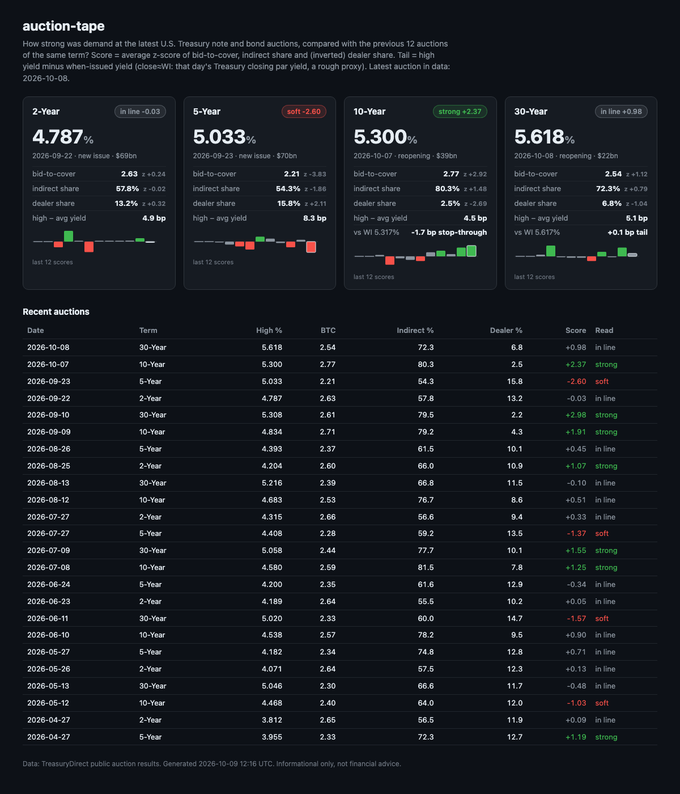

# auction-tape

[](https://github.com/BrickerP/auction-tape/actions/workflows/ci.yml)


[](LICENSE)

**How strong was demand at the latest U.S. Treasury auction, compared with its own history?**

`auction-tape` is a small, standard-library-only Python CLI. It pulls recent 2Y / 5Y / 10Y / 30Y
(and optionally 3Y / 7Y / 20Y) note and bond auction results from TreasuryDirect's free public API and
gives each auction a **demand score** against the previous 12 auctions of the same tenor. It can also
show the **tail or stop-through** and render a **one-page HTML dashboard** (or JSON / Markdown).



## What it measures

For every auction it reads the high (stop-out) yield, bid-to-cover, and the direct / indirect / primary-dealer
shares of competitive awards. Then it computes:

| Metric | Meaning |
| --- | --- |
| **Demand score** | Average of three z-scores against the previous `--window` (default 12) same-tenor auctions: bid-to-cover (higher = stronger), indirect share (higher = stronger; includes foreign official buyers) and dealer share (inverted, since dealers are the buyer of last resort). An auction is never part of its own baseline. ≥ +1 = **strong**, ≤ −1 = **soft**, otherwise **in line**. |
| **Tail / stop-through** | High yield minus the when-issued (WI) yield, in bp. Positive = tail (weak), negative = stop-through (strong). Pass the WI yield with `--wi 10Y=4.512`, or use `--approx-wi` to approximate it with that day's Treasury closing par yield. The close comes a few hours after the 1pm ET auction, so treat it as a rough proxy (see the note below). |
| **High − average yield** | How spread out the accepted bids were, in bp. |

It's a transparent summary statistic, not a forecast and not financial advice.

## Install

Needs Python 3.10+ and nothing else.

```bash
pip install git+https://github.com/BrickerP/auction-tape
# or, from a clone:
pip install -e ".[test]"
```

## Usage

```bash
auction-tape                                   # text table of the latest 2Y/5Y/10Y/30Y auctions
auction-tape --approx-wi -o tape.html --open   # add tail vs the day's close, write and open the dashboard
auction-tape --wi 10Y=4.512 --wi 30Y=4.801     # tail/stop-through against your own WI yields
auction-tape --terms all --json                # every nominal coupon tenor, as JSON
auction-tape --md                              # Markdown table, ready to paste into notes
auction-tape --save-raw raw.json               # keep the raw API response; replay later with --from-file raw.json
```

Options: `--days` (history to fetch, default 420), `--window` (baseline size, default 12), `--terms 2,10,30`,
`--closes-file` (use a saved Treasury par-curve CSV with `--approx-wi`), `--timeout`.

## Sample output

Live run on 2026-10-09, with the published when-issued yields at the bid deadline for the latest 10Y and 30Y
(`auction-tape --wi 10Y=5.317 --wi 30Y=5.617`):

```text
term     auction      high%   btc  indir%  dealer%  score  read      tail bp
----------------------------------------------------------------------------
2-Year   2026-09-22   4.787  2.63    57.8     13.2  -0.03  in line         –
5-Year   2026-09-23   5.033  2.21    54.3     15.8  -2.60  soft            –
10-Year  2026-10-07   5.300  2.77    80.3      2.5  +2.37  strong       -1.7
30-Year  2026-10-08   5.618  2.54    72.3      6.8  +0.98  in line      +0.1
```

The Oct 7 10Y reopening cleared at 5.300%, the highest 10Y auction yield since 2000, yet it posted the highest
demand score of any 10Y scored in the data (since Jan 2026): bid-to-cover z +2.9, 80.3% indirect, 2.5% dealer, and a 1.7 bp stop-through.

> **About `--approx-wi`:** the closing yield can be far from the WI yield at 1pm ET. On that same 10Y, the day's
> close (5.28%) gives a +2.0 bp "tail", while the real result against WI was a 1.7 bp stop-through, because yields
> rallied after the auction. Use `--wi` whenever you have the number.

`--json` gives one object per tenor with every input and component, e.g. `z_bid_to_cover`, `z_indirect`,
`z_dealer_inverted`, `demand_score`, `label`, `wi_yield`, `wi_source` (`given` or `close`) and `tail_bp`.

## Data sources

- Auction results: TreasuryDirect, `https://www.treasurydirect.gov/TA_WS/securities/auctioned` (public, no key).
- Closing yields for `--approx-wi`: U.S. Treasury daily par yield curve CSV (public, no key).

TIPS, FRNs, bills and auctions that haven't happened yet are skipped. Reopenings count toward their tenor.

## Development

```bash
pip install -e ".[test]"
pytest -q          # tests use saved fixtures and block all network access
```

## Related

Pairs with [fed-pulse](https://github.com/BrickerP/fed-pulse): fed-pulse reads the Fed (FOMC minutes and the
yield curve), auction-tape reads who is actually buying the Treasury supply.

## License

[MIT](LICENSE)

---

Work with me: [brickerp.github.io/hire](https://brickerp.github.io/hire/)
